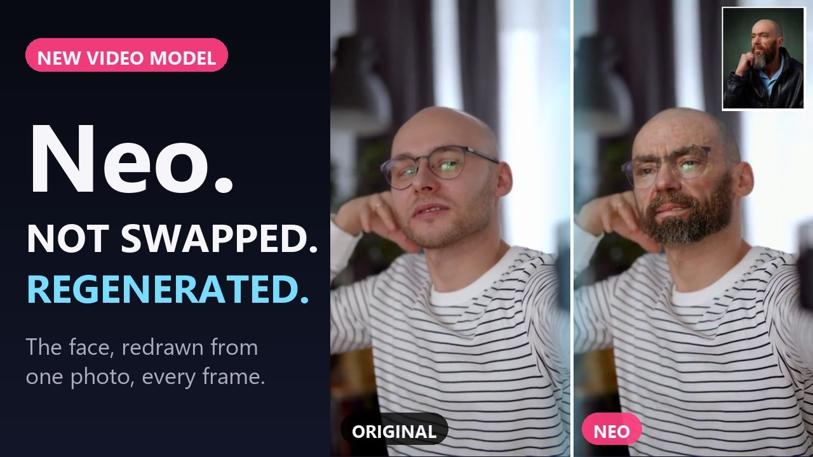
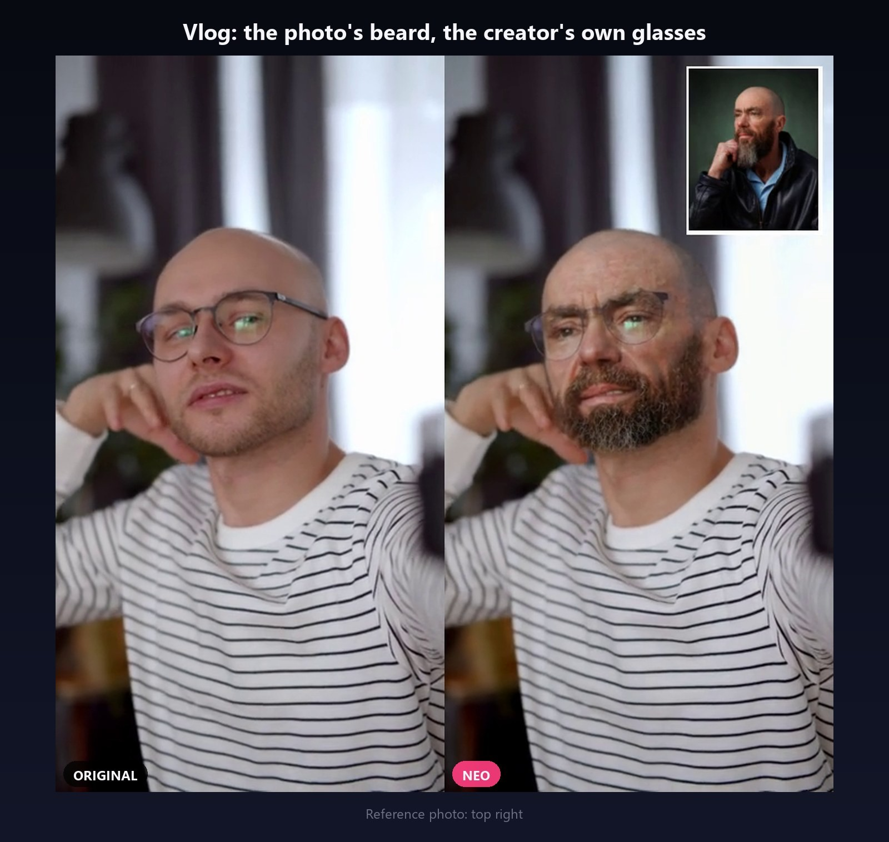
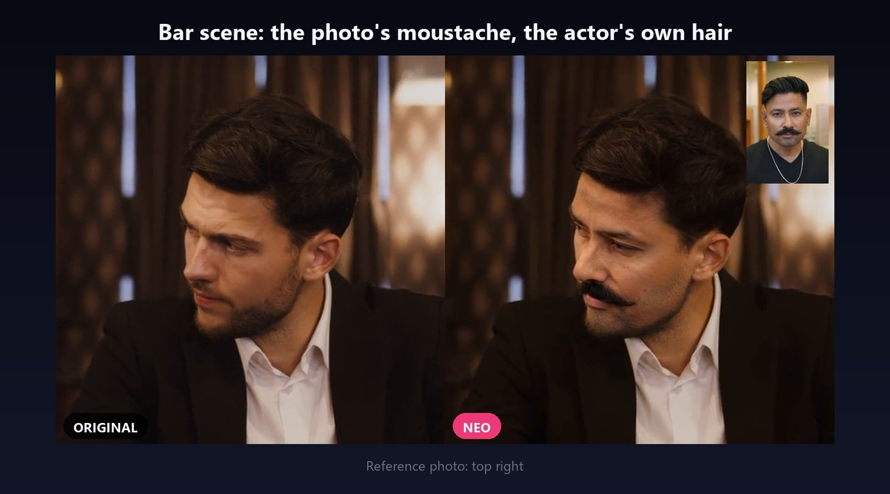
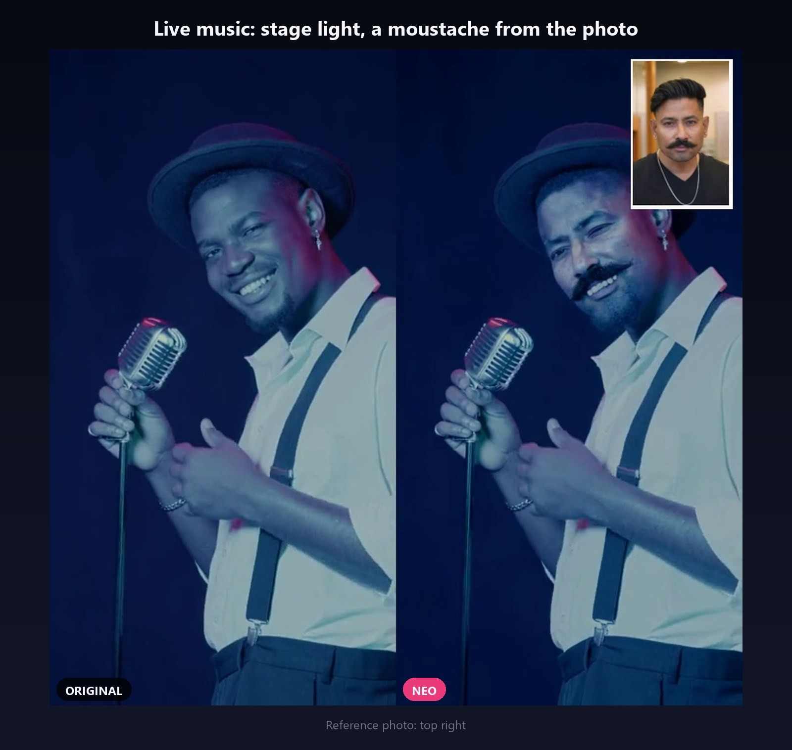
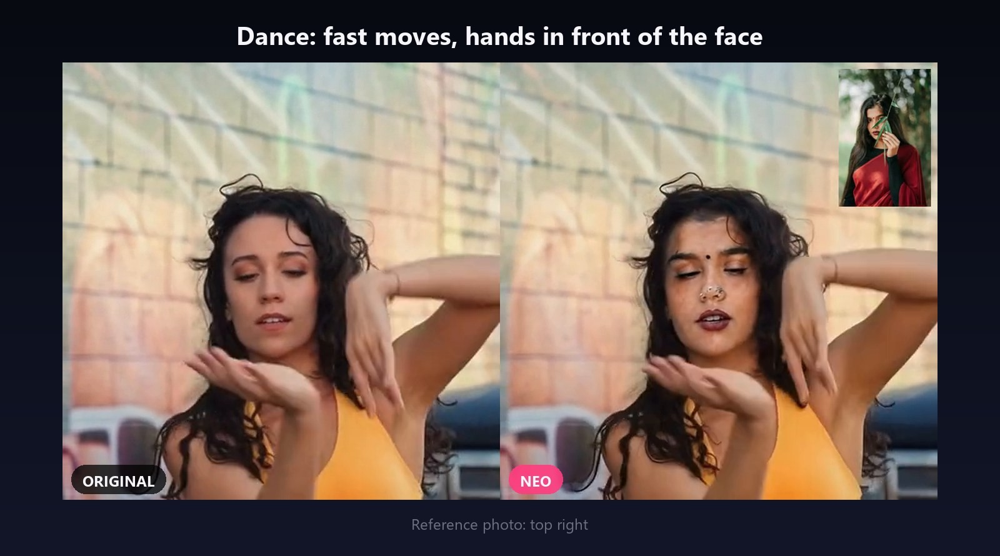
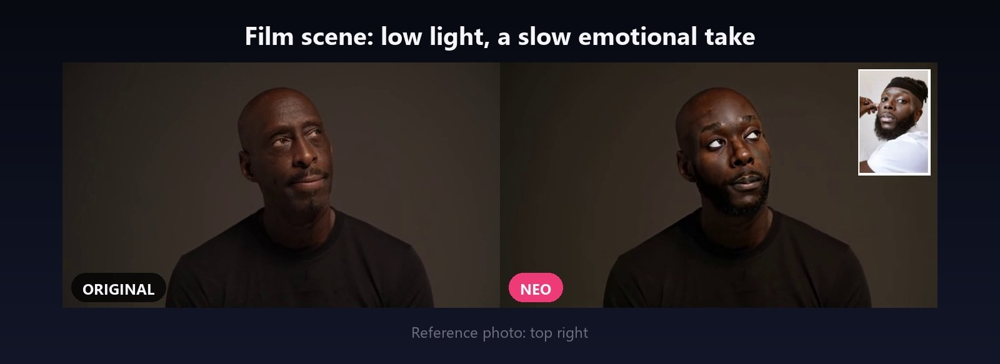
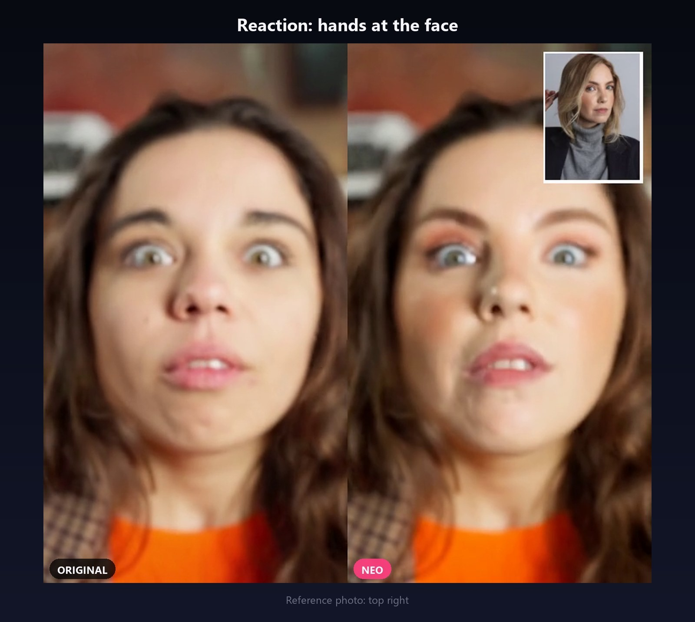
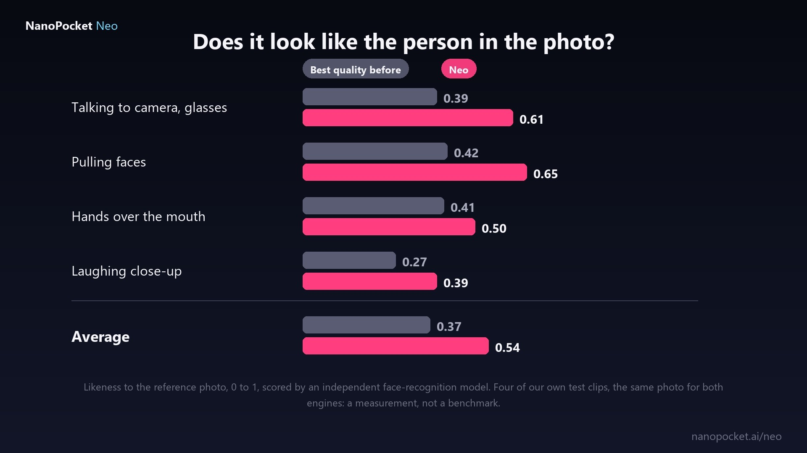

# NanoPocket · Neo – Not Swapped. Regenerated.

### Our first diffusion video model. It redraws the face from your photo in every frame.

    

## 🎬 Demo video

▶️ **[Watch on YouTube](https://youtu.be/Lz5ppc18C0E)**

## ✨ About Neo

Neo is NanoPocket's first diffusion video model, trained and tuned in-house, and it now makes every Best quality video in Video FaceSwap 2.5. Instead of pasting a face onto each frame, it draws the face again from your photo, frame by frame, so what makes that face recognisable comes through: a beard, the shape of the jaw and nose, the lines around the eyes. The expressions, the light and the movement still come from your video. You told us a swapped face did not always look enough like the photo; Neo is our first answer.

- The face redrawn from your photo in every frame, not pasted on
- Looks more like the person you chose: likeness 0.54 against 0.37 before, on our test clips
- Expressions, light and movement come from your video
- Holds up in low light, under stage light, with glasses and with hands near the face
- Best quality costs the same as before, and a video that fails is refunded
- Launch week: Neo videos cost 30% fewer credits, until Nov 27, 7 pm PT
- About 6–7 minutes for a 10-second 1080p clip once it starts

## 🚀 Try it now

- **Try Neo: [nanopocket.ai/facestudio-v/launch?m=quality](https://nanopocket.ai/facestudio-v/launch?m=quality)**
- **About Neo: [nanopocket.ai/neo](https://nanopocket.ai/neo)**
- **Video FaceSwap 2.5: [nanopocket.ai/facestudio-v](https://nanopocket.ai/facestudio-v)**

## 🖼 Highlights

<table><tr><td align="center" valign="top" width="50%"> <b>Vlog: the photo&#x27;s beard, the creator&#x27;s own glasses</b></td><td align="center" valign="top" width="50%"> <b>Bar scene: the photo&#x27;s moustache, the actor&#x27;s own hair</b></td></tr></table>

<table><tr><td align="center" valign="top" width="50%"> <b>Live music: stage light, a moustache from the photo</b></td><td align="center" valign="top" width="50%"> <b>Dance: fast moves, hands in front of the face</b></td></tr></table>

<table><tr><td align="center" valign="top" width="50%"> <b>Film scene: low light, a slow emotional take</b></td><td align="center" valign="top" width="50%"> <b>Reaction: hands at the face</b></td></tr></table>

<table><tr><td align="center" valign="top" width="50%"> <b>Likeness to the photo: Best quality before vs Neo</b></td></tr></table>

## 🏢 About NanoPocket

NanoPocket builds generative AI creative tools for images, video and faces. Use them online in your browser, or as desktop apps that run 100% locally on your own GPU, so your data never leaves your machine. The suite covers AI photo retouching, video face swap and head swap, facial editing, virtual try-on, image generation and editing, image and video upscaling, and AI video generation.

## 🔗 Links

- **Website:** https://nanopocket.ai
- **Download:** https://nanopocket.ai/download
- **Hugging Face:** https://huggingface.co/Nanopocket-ai
- **YouTube:** https://www.youtube.com/@NanoPocket_ai
- **GitHub:** https://github.com/Nanopocket-ai
- **Contact:** tech@nanopocket.ai

---

AI-generated with stock footage and photos. Use only faces you have the right to use. Likeness is scored 0 to 1 by an independent face-recognition model that neither engine was trained against, on four of our own test clips with the same photo for both engines: a measurement, not a benchmark. Neo replaces the face, not the hair or the shape of the head (Headswap does those), and swaps one person per video. Videos from an account that has never topped up credits carry a moving NanoPocket watermark.

© 2026 NanoPocket. All rights reserved. Synced automatically from https://nanopocket.ai.
